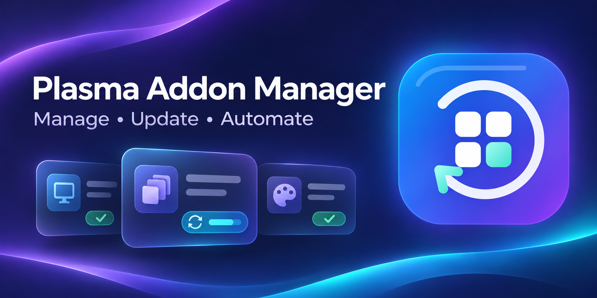

  

  <h1>Plasma Addon Manager</h1>

  
<strong>One place for your KDE Plasma 6 add-ons.</strong> 
  <strong>Wszystkie dodatki KDE Plasma 6 w jednym miejscu.</strong>

  

    
    
    
    
  

  

    
    
    
  

  

    <a href="https://github.com/wolfgangxxiii/plasma-addon-manager/releases"><strong>⬇️ Download AppImage / Pobierz AppImage</strong></a>
    &nbsp;·&nbsp;
    <a href="https://github.com/wolfgangxxiii/plasma-addon-manager/issues">🐛 Issues / Zgłoś problem</a>
    &nbsp;·&nbsp;
    <a href="https://github.com/wolfgangxxiii/plasma-addon-manager/actions">⚙️ Builds</a>
  

  
<a href="#polski">🇵🇱 Polski</a> &nbsp; | &nbsp; <a href="#english">🇬🇧 English</a>

---

## 🇵🇱 Polski

**Plasma Addon Manager** to graficzna aplikacja do zarządzania dodatkami KDE Plasma 6 na różnych dystrybucjach Linuksa. Łączy natywny interfejs **Qt 6 + KDE Kirigami** z narzędziem [plasmoid-updater](https://github.com/uwuclxdy/plasmoid-updater) oraz własnym pomocnikiem i agentem napisanym w **Rust**.

Sprawdzaj dostępne aktualizacje, przeglądaj zainstalowane dodatki, uruchamiaj aktualizację ręcznie albo skonfiguruj ją raz, aby działała w tle.

> [!IMPORTANT]
> **Wersja 0.4.5 jest wydaniem rozwojowym (preview), a nie stabilnym wydaniem 1.0.**
> Obsługuje automatyczne aktualizacje po włączeniu ich przez użytkownika. Zgodność AppImage ze wszystkimi wymienionymi dystrybucjami nie została jeszcze w pełni zweryfikowana.

### ✨ Najważniejsze możliwości

| Sekcja | Co umożliwia? |
| :-- | :-- |
| 🏠 **Pulpit** | Stan środowiska i narzędzi, wersja aktualizatora i agenta, stan harmonogramu, następny termin oraz wskazówki dotyczące kolejnego kroku. |
| 🧩 **Dodatki Plasma** | Lista zainstalowanych dodatków, informacje o wersjach i typach, dostępne aktualizacje oraz problemy wykryte podczas skanowania. |
| 🔄 **Aktualizacje** | Sprawdzanie nowych wersji, symulacja zmian i ręczne aktualizowanie dodatków po potwierdzeniu. |
| ⏱️ **Automatyzacja** | Harmonogram co **6, 12 lub 24 godziny**, wykluczenia dodatków, opcjonalny restart Plasma i powiadomienia KDE. |
| 📋 **Dziennik** | Historia operacji z godzinami, wynikami i komunikatami pomocnika. Dziennik sesji pozostaje dostępny do zamknięcia okna. |
| ℹ️ **O programie** | Dane aplikacji, autor, licencja oraz wygodne odnośniki do kodu, wydań i zgłaszania błędów. |

**Dopracowany interfejs:** automatyczny lub ręczny wybór języka polskiego i angielskiego, motyw zgodny z KDE Plasma, dolny pasek postępu z czasem operacji i osobny panel kolorowych powiadomień po prawej stronie (w węższych oknach jako wysuwany panel).

### 🐧 Dystrybucje i zależności

Program wykrywa dystrybucję i przygotowuje wymagane narzędzia w odpowiedni sposób. **Do działania wymagane są KDE Plasma 6 i Linux x86_64.**

| System | Sposób przygotowania brakującego <code>bsdtar</code> |
| :-- | :-- |
| **Bazzite KDE** | Istniejące narzędzie lub <code>libarchive</code> przez Homebrew użytkownika; bez zmiany obrazu systemu. |
| **openSUSE Tumbleweed** | Pakiet <code>bsdtar</code> przez Zypper. |
| **Fedora KDE** | Wymagany pakiet przez DNF. |
| **Debian / Ubuntu / Kubuntu / KDE neon** | Pakiet <code>libarchive-tools</code> przez APT. |
| **Arch Linux / CachyOS** | Pakiet <code>libarchive</code> przez Pacman. |

Na tradycyjnych dystrybucjach instalacja brakującego pakietu systemowego może wymagać **graficznej autoryzacji PolicyKit**. Codzienne sprawdzanie dodatków i ich aktualizacje w katalogu użytkownika nie wymagają uprawnień administratora.

### 📥 Pobieranie i instalacja

1. Otwórz **[GitHub Releases](https://github.com/wolfgangxxiii/plasma-addon-manager/releases)** i pobierz plik <code>Plasma-Addon-Manager-v0.4.5-x86_64.AppImage</code>. To samodzielny plik wykonywalny — nie archiwum ZIP.
2. W Dolphin wybierz **Właściwości → Uprawnienia** i zaznacz możliwość uruchamiania pliku jako programu.
3. Otwórz AppImage dwukrotnym kliknięciem.
4. Na **Pulpicie** wybierz **Zainstaluj / sprawdź wersję**, aby zainstalować lub sprawdzić <code>plasmoid-updater</code> i niezbędne zależności.
5. Otwórz **Dodatki Plasma** i sprawdź dostępne aktualizacje.

**Bazzite KDE:** możesz zainstalować [Gear Lever](https://github.com/mijorus/gearlever) z Bazaar, otworzyć nim pobrany AppImage i wybrać **Integruj**. Aplikacja pojawi się wtedy w menu KDE. Gear Lever nie jest wymagany do uruchomienia programu.

**Opcjonalnie z terminala:**

~~~bash
chmod +x Plasma-Addon-Manager-v0.4.5-x86_64.AppImage
./Plasma-Addon-Manager-v0.4.5-x86_64.AppImage
~~~

> [!NOTE]
> Projekt obecnie publikuje **AppImage**, nie udostępnia pakietów DEB ani Flatpak. Zainstalowanie samej aplikacji nie instaluje automatycznie aktualizatora i nie włącza harmonogramu.

### ⏰ Automatyczne aktualizacje

1. Po zainstalowaniu aktualizatora przejdź do **Automatyzacja**.
2. Wybierz częstotliwość (**6 / 12 / 24 h**) i ustaw opcje powiadomień, wykluczeń lub restartu Plasma.
3. Kliknij **Zapisz i zastosuj**, aby utworzyć własny timer i usługę <code>systemd --user</code>.
4. Użyj **Testuj konfigurację**, by sprawdzić zależności, agenta, usługę i harmonogram.

Osobny <code>plasma-addon-manager-agent</code> wykonuje zaplanowane zadania **również po zamknięciu okna aplikacji**. Możesz ponadto naprawić agenta, ręcznie uruchomić usługę lub obejrzeć jej dziennik.

> [!CAUTION]
> Jeśli korzystasz ze starszego harmonogramu aplikacji Bazzite/Debian, jego przejęcie **wymaga osobnej, wyraźnej zgody**. Program tworzy kopie zapasowe i w razie niepowodzenia próbuje przywrócić wcześniejszy stan. Bez tej zgody nie wyłącza istniejących timerów.

### 🛡️ Zakres działania i bezpieczeństwo

- Aktualizuje **dodatki KDE Store**, nie cały system operacyjny.
- Pobiera <code>plasmoid-updater</code> z wydania projektu źródłowego i sprawdza **SHA-256** przed instalacją w <code>~/.local/bin</code>.
- W trybie normalnym działa na koncie użytkownika, bez <code>sudo</code>.
- Przy brakujących zależnościach może — po zatwierdzeniu — zainstalować pakiet <code>bsdtar</code> lub jego odpowiednik przez menedżer pakietów na systemach modyfikowalnych.
- Nie modyfikuje atomowego obrazu Bazzite i nie nadpisuje plików wcześniejszych aplikacji.
- Dla skanowania i podglądu używa operacji odczytu; ręczne zmiany wymagają potwierdzenia.

### 🧰 Rozwiązywanie problemów

| Problem | Co sprawdzić? |
| :-- | :-- |
| AppImage nie uruchamia się | Uprawnienie wykonywania pliku, architekturę x86_64 i sesję Plasma 6. |
| Brakuje <code>plasmoid-updater</code> lub <code>bsdtar</code> | Na Pulpicie kliknij **Zainstaluj / sprawdź wersję**. |
| Nie widać wszystkich dodatków systemowych | Odczyt elementów systemowych jest opcjonalny; dodatki użytkownika pozostają dostępne bez hasła administratora. |
| Harmonogram lub agent nie działa | Na karcie **Automatyzacja** uruchom test, a następnie skorzystaj z naprawy agenta i dziennika usługi. |
| Pasek postępu nie pokazuje procentów | Gdy narzędzie nie udostępnia procentów, pasek celowo pokazuje animację oraz aktualny etap i czas pracy. |

W razie problemów otwórz [Issues](https://github.com/wolfgangxxiii/plasma-addon-manager/issues) i dołącz informacje o dystrybucji, wersji Plasma oraz komunikat z dziennika (bez danych prywatnych).

### 🛠️ Budowanie ze źródeł

Wymagane: **CMake 3.24+**, kompilator C++17, Ninja, **Qt 6.5+**, Qt Quick/Quick Controls, **KDE Kirigami (KF6)**, **QQC2DesktopStyle**, Extra CMake Modules, **Rust i Cargo**.

~~~bash
cmake -S . -B build -G Ninja -DCMAKE_BUILD_TYPE=Release
cmake --build build --parallel
./build/bin/plasma-addon-manager
~~~

Testy backendu:

~~~bash
cargo test --manifest-path backend/Cargo.toml
~~~

Budowanie AppImage na odpowiednio przygotowanym systemie Linux x86_64:

~~~bash
bash scripts/build-appimage.sh
~~~

Wynik zostanie zapisany w katalogu <code>dist/</code>. Skrypt sprawdza sumy kontrolne pobieranych narzędzi pakujących i wymaga dostępności odpowiednich modułów Qt/Kirigami.

---

## 🇬🇧 English

**Plasma Addon Manager** is a graphical application for managing **KDE Plasma 6 add-ons** across Linux distributions. It combines a native **Qt 6 / KDE Kirigami** interface with the independent [plasmoid-updater](https://github.com/uwuclxdy/plasmoid-updater) utility and a **Rust** backend.

Browse installed add-ons, check for updates, review changes before applying them, and optionally schedule automatic updates in the background.

> [!IMPORTANT]
> **Version 0.4.5 is a development preview, not a stable 1.0 release.** Automatic updates are opt-in. The AppImage has not yet been fully validated on every listed Linux distribution.

### ✨ Features

| Page | What it does |
| :-- | :-- |
| 🏠 **Dashboard** | Environment and prerequisite checks, updater/agent versions, timer health, next run and suggested next action. |
| 🧩 **Plasma add-ons** | Installed add-on inventory, types, versions, available updates and per-add-on issues. |
| 🔄 **Updates** | Read-only update checks, dry-run preview and confirmed manual updates. |
| ⏱️ **Automation** | **6/12/24-hour** schedules, exclusions, optional Plasma restart and KDE desktop notifications. |
| 📋 **Journal** | Time-stamped session actions and output; separate access to the user service journal. |
| ℹ️ **About** | App identity, project links, author, credits and license. |

The adaptive interface follows the active Plasma theme, offers **Polish and English**, includes a persistent operation footer with elapsed time, and displays color-coded notices in a dedicated right-side panel or drawer.

### 🐧 Linux support

The application targets **KDE Plasma 6 on Linux x86_64**. Its prerequisite installer handles these distribution families:

| Distribution | Missing <code>bsdtar</code> prerequisite |
| :-- | :-- |
| **Bazzite KDE** | Reuse an existing binary or install <code>libarchive</code> using user-local Homebrew without changing the OS image. |
| **openSUSE Tumbleweed** | <code>bsdtar</code> through Zypper. |
| **Fedora KDE** | Corresponding package through DNF. |
| **Debian / Ubuntu / Kubuntu / KDE neon** | <code>libarchive-tools</code> through APT. |
| **Arch Linux / CachyOS** | <code>libarchive</code> through Pacman. |

Installing a missing system prerequisite on a mutable distribution may request graphical **PolicyKit authorization**. Ordinary add-on checks and user-local updates do not require root access.

### 📥 Download and first run

1. Download **<code>Plasma-Addon-Manager-v0.4.5-x86_64.AppImage</code>** from [GitHub Releases](https://github.com/wolfgangxxiii/plasma-addon-manager/releases). Download the executable itself, not an Actions ZIP.
2. In Dolphin, use **Properties → Permissions** to allow executing the file.
3. Open the AppImage.
4. On **Dashboard**, select **Install / check version** to set up <code>plasmoid-updater</code> and prerequisites.
5. Open **Plasma add-ons** to inspect installed items and check for updates.

**Bazzite KDE:** optionally use [Gear Lever](https://github.com/mijorus/gearlever) from Bazaar to integrate the AppImage with your KDE application menu. Gear Lever is not required for direct execution.

**Terminal alternative:**

~~~bash
chmod +x Plasma-Addon-Manager-v0.4.5-x86_64.AppImage
./Plasma-Addon-Manager-v0.4.5-x86_64.AppImage
~~~

> [!NOTE]
> The current release format is **AppImage only** (no DEB or Flatpak). Installing the graphical app alone does not install <code>plasmoid-updater</code> or enable a background schedule.

### ⏰ Background updates

1. Install or verify the updater from **Dashboard**.
2. Open **Automation**, select **6, 12 or 24 hours**, and configure exclusions, notifications and optional Plasma restart.
3. Choose **Save and apply** to configure the app-owned <code>systemd --user</code> service and timer.
4. Run the configuration test to check requirements, agent, service and schedule.

The independent <code>plasma-addon-manager-agent</code> performs scheduled work **even when the GUI is closed**. The app also supports agent repair, manual service execution and journal inspection.

> [!CAUTION]
> Existing schedules from the earlier Bazzite or Debian GUI are not silently replaced. Migration requires **explicit consent**, creates backups and includes rollback behavior if configuration fails.

### 🛡️ Safety and scope

- Manages **KDE Store add-ons**, not general operating-system upgrades.
- Downloads the upstream <code>plasmoid-updater</code> release with **SHA-256 verification** and installs it under <code>~/.local/bin</code>.
- Uses user-level permissions for normal operations.
- Installs a missing system prerequisite only through a confirmed action; traditional distributions may show a PolicyKit prompt.
- Leaves the atomic Bazzite OS image and old updater configuration files intact.
- Keeps inventory and preview operations read-only; manual updates require confirmation.

### 🧰 Troubleshooting

| Symptom | Suggested action |
| :-- | :-- |
| AppImage will not launch | Check executable permission, x86_64 architecture and your Plasma 6 session. |
| Updater or <code>bsdtar</code> is missing | Use **Install / check version** on the Dashboard. |
| Some system-wide add-ons are absent | System-wide inventory may be omitted when reading it would require interactive administrator access. |
| Agent or timer is unhealthy | Run the **Automation** test, inspect the journal and use **Repair agent** if indicated. |
| Progress is animated without a percentage | The upstream CLI does not always report progress percentages; the elapsed time and current step remain visible. |

For bug reports and feature requests, open [GitHub Issues](https://github.com/wolfgangxxiii/plasma-addon-manager/issues). Include your distribution, Plasma version and relevant log output without private information.

### 🛠️ Build from source

Requirements: **CMake 3.24+**, C++17 toolchain, Ninja, **Qt 6.5+**, Qt Quick / Quick Controls 2, **KDE Kirigami (KF6)**, **QQC2DesktopStyle**, Extra CMake Modules, **Rust and Cargo**.

~~~bash
cmake -S . -B build -G Ninja -DCMAKE_BUILD_TYPE=Release
cmake --build build --parallel
./build/bin/plasma-addon-manager
~~~

Backend tests:

~~~bash
cargo test --manifest-path backend/Cargo.toml
~~~

Build an AppImage on a suitable Linux x86_64 host:

~~~bash
bash scripts/build-appimage.sh
~~~

The output is written to <code>dist/</code>. The packaging script validates downloaded packaging tools using pinned SHA-256 hashes and checks the required Qt/Kirigami components.

---

## 🏗️ Architecture / Architektura

~~~mermaid
flowchart TD
    GUI["Qt 6 + Kirigami GUI"] --> Helper["Rust helper"]
    Helper --> Updater["plasmoid-updater"]
    Helper --> Agent["Rust background agent"]
    Agent --> Timer["systemd --user service + timer"]
    Agent --> Updater
~~~

The GUI handles interaction while the helper performs allow-listed operations; scheduled updates run through a separate user-level agent. / Interfejs obsługuje użytkownika, pomocnik wykonuje dozwolone operacje, a oddzielny agent realizuje zadania według harmonogramu.

## 🗺️ Roadmap / Plan rozwoju

| Version / Wersja | Goal / Cel | Status |
| :-- | :-- | :-- |
| **0.1–0.3** | Qt/Kirigami foundations, installer, systemd automation / Podstawy, instalator, harmonogram | ✅ |
| **0.4.0–0.4.5** | Add-on inventory, status, logs, notifications, About page / Dodatki, stan, dziennik, powiadomienia, O programie | ✅ Preview |
| **0.5.0** | Reliability, migration/rollback and interface tests / Niezawodność, testy migracji i interfejsu | 🔜 |
| **1.0.0** | Cross-distribution validation and stable AppImage / Testy wielu dystrybucji i stabilna wersja | 🔜 |

## 🎨 Branding / Grafiki projektu

The new application icon and README banner use a consistent blue-violet palette and a four-tile update symbol. / Nowa ikona aplikacji i baner README korzystają ze spójnej niebiesko-fioletowej kolorystyki i symbolu aktualizowanych dodatków.

| Asset / Zasób | File / Plik |
| :-- | :-- |
| README banner / Baner | [PNG](assets/plasma-addon-manager-banner.png) |
| Application icon / Ikona programu | [SVG](assets/io.github.wolfgangxxiii.PlasmaAddonManager.svg) |
| PNG icons / Ikony PNG | [16](assets/plasma-addon-manager-icon-16.png) · [32](assets/plasma-addon-manager-icon-32.png) · [48](assets/plasma-addon-manager-icon-48.png) · [64](assets/plasma-addon-manager-icon-64.png) · [128](assets/plasma-addon-manager-icon-128.png) · [256](assets/plasma-addon-manager-icon-256.png) · [512](assets/plasma-addon-manager-icon-512.png) · [1024](assets/plasma-addon-manager-icon-1024.png) |
| Complete asset pack / Pełny pakiet | [Download ZIP / Pobierz ZIP](assets/plasma-addon-manager-branding.zip) |

## 🤝 Credits / Podziękowania

- **Author / Autor:** [Szymon Bławat (wolfgangxxiii)](https://github.com/wolfgangxxiii)
- **Upstream updater / Silnik aktualizacji:** [uwuclxdy/plasmoid-updater](https://github.com/uwuclxdy/plasmoid-updater) — independent project with its own authors and license.
- **Earlier GUI projects / Wcześniejsze interfejsy:** [Bazzite GUI](https://github.com/wolfgangxxiii/bazzite-kde-installer-plasmoid-updater-gui) · [Debian/Ubuntu GUI](https://github.com/wolfgangxxiii/deb-kde-installer-plasmoid-updater-gui)
- **Desktop ecosystem / Środowisko graficzne:** [KDE Plasma](https://kde.org/plasma-desktop/) · [Kirigami](https://develop.kde.org/frameworks/kirigami/)

## 📜 License / Licencja

Copyright © 2026 **Szymon Bławat**.

Licensed under **GNU GPL-3.0-or-later** — see [LICENSE](LICENSE). The application and its visual assets belong to this project; upstream components retain their respective licenses and authorship. / Aplikacja i jej grafiki są częścią tego projektu; niezależne komponenty zachowują własne licencje i autorów.

   
  Made for KDE Plasma 6 • Created by wolfgangxxiii

